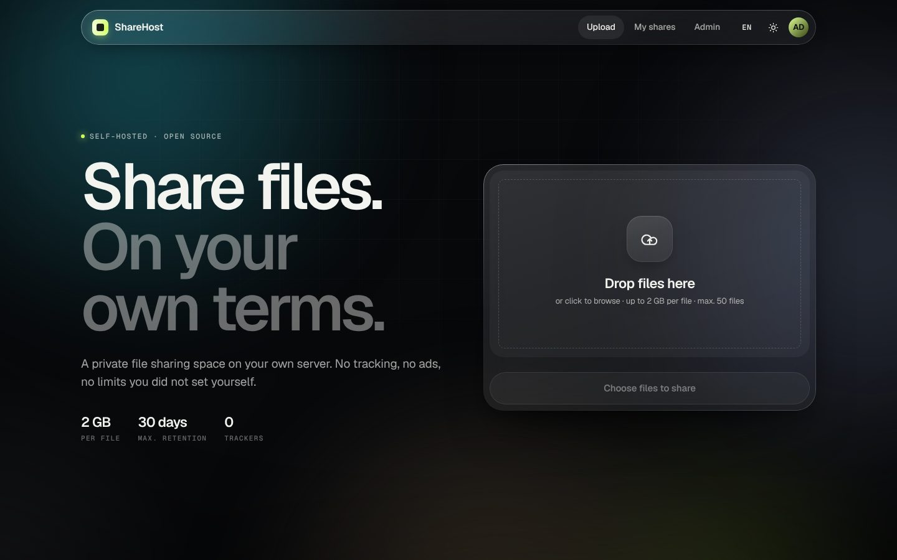
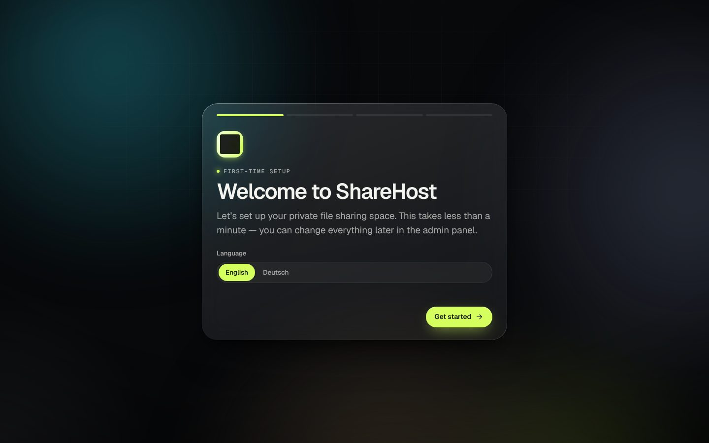
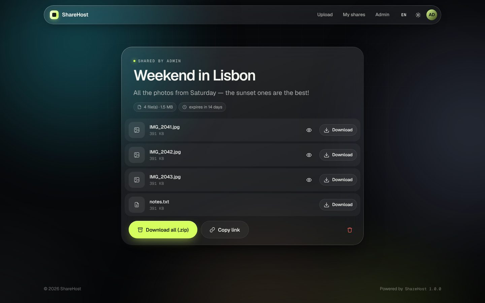
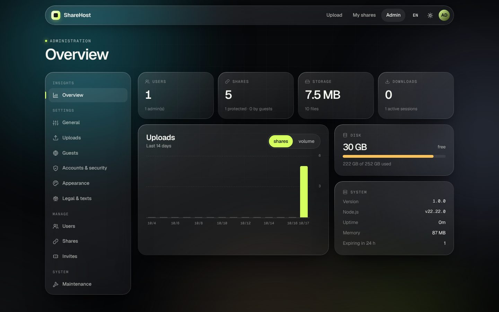
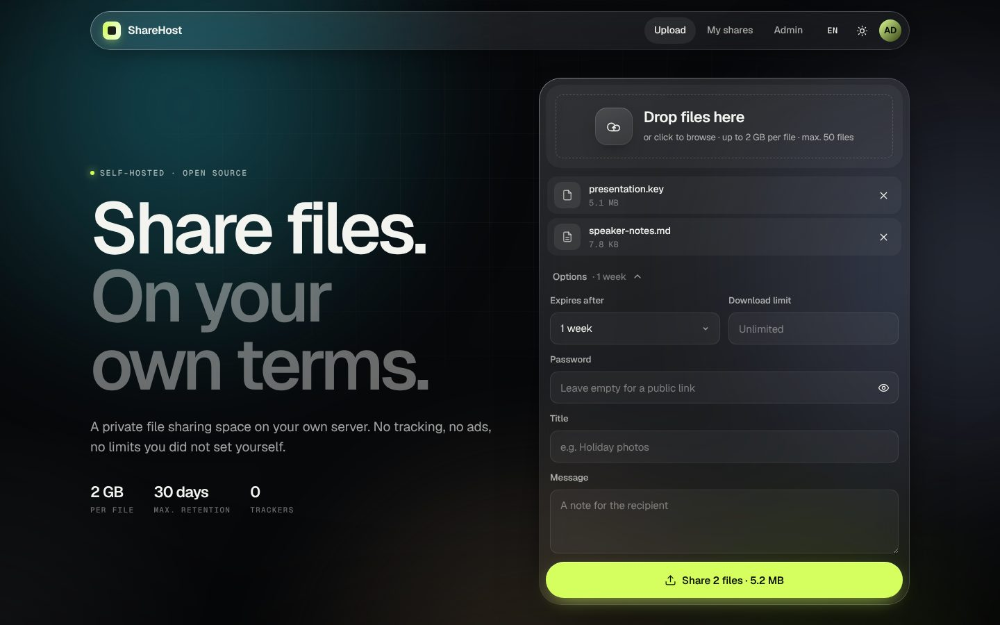
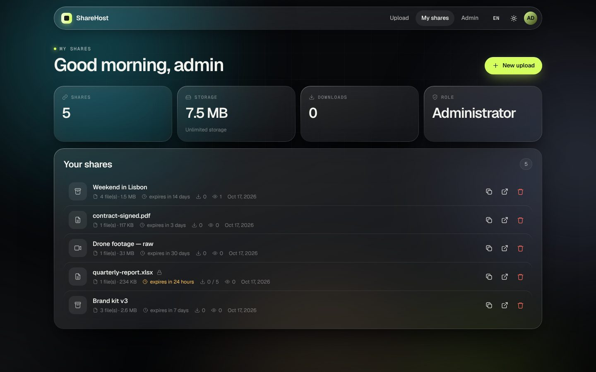
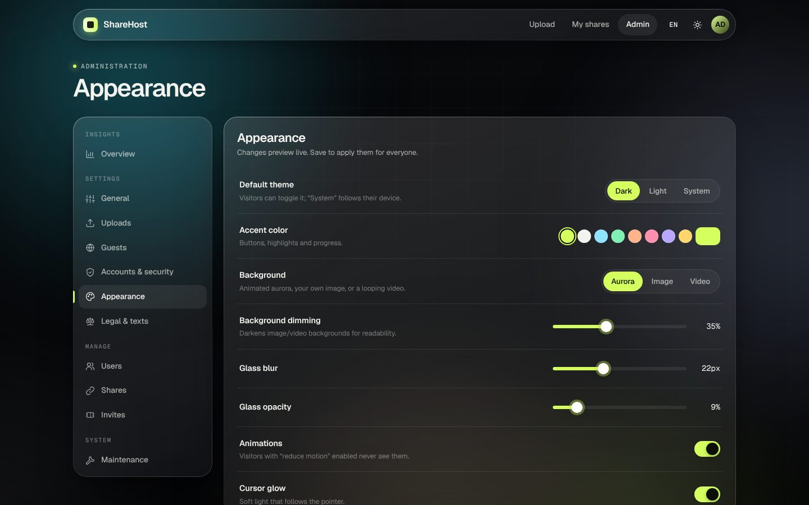

# ShareHost

**Open-source, self-hosted file sharing with a clean glass interface.**
Drop files, get a link, done — on your own server, with your own rules.



## Features

- **Drag & drop uploads** with live progress, speed and ETA — or paste files with <kbd>Ctrl</kbd>+<kbd>V</kbd>
- **Share links** with optional **password**, **expiry** and **download limit**
- **Download all as ZIP** (streamed, no temp files) plus inline previews for images, video and audio
- **First-run setup wizard** that creates the administrator account
- **Admin panel** where everything is configurable: limits, file types, guest uploads, registration
  (closed / invite-only / open), quotas, sessions, branding, legal links — with live preview
- **Users & invites**: create, edit, disable and delete users; single-use invite codes
- **Glass design** with animated aurora background, or your own **background image or looping video**
  (see [AI prompts for backgrounds](docs/BACKGROUND_PROMPTS.md)), custom accent colour, logo, dark / light theme
- **English & German** UI, auto-cleanup of expired shares, no external requests (fonts are bundled), no tracking
- One small Node.js process, SQLite built in — no database server, no build step

| Setup | Share page | Admin |
|---|---|---|
|  |  |  |
|  |  |  |

## Quick start

### Docker (recommended)

```bash
git clone https://github.com/tamino112/sharehost.git
cd sharehost
docker compose up -d
```

Open <http://localhost:3000> — you'll be taken to the setup wizard to create your admin account.
All data (database, uploads, branding) lives in the `sharehost-data` volume.

### Without Docker

Requires **Node.js 22.5 or newer** (uses the built-in `node:sqlite`).

```bash
git clone https://github.com/tamino112/sharehost.git
cd sharehost
npm install --omit=dev
npm start
```

Data is stored in `./data` by default.

## Configuration

Almost everything is configured in the admin panel. A few things are set through environment variables:

| Variable | Default | Description |
|---|---|---|
| `PORT` | `3000` | HTTP port |
| `HOST` | `0.0.0.0` | Bind address |
| `DATA_DIR` | `./data` | Where the database, uploads and branding files are stored |
| `TRUST_PROXY` | – | Number of reverse proxies in front of ShareHost (e.g. `1`). Needed for correct client IPs and secure cookies behind nginx / Caddy / Traefik |
| `SECURE_COOKIES` | auto | Set to `true` to always mark cookies as `Secure` |

### Reverse proxy

Put ShareHost behind HTTPS. Make sure the proxy allows large request bodies and doesn't buffer uploads.

**Caddy**

```caddy
share.example.com {
    reverse_proxy localhost:3000
}
```

**nginx**

```nginx
server {
    server_name share.example.com;
    client_max_body_size 0;            # limits are enforced by ShareHost
    proxy_request_buffering off;       # stream uploads straight through

    location / {
        proxy_pass http://127.0.0.1:3000;
        proxy_set_header Host $host;
        proxy_set_header X-Forwarded-For $proxy_add_x_forwarded_for;
        proxy_set_header X-Forwarded-Proto $scheme;
        proxy_read_timeout 1h;
        proxy_send_timeout 1h;
    }
}
```

Then set `TRUST_PROXY=1` and, in *Admin → General*, the **Public URL** (e.g. `https://share.example.com`).

## Backups

Everything is in `DATA_DIR`:

```
data/
├── sharehost.db        # users, shares, settings (SQLite)
├── uploads/            # uploaded files (random names)
└── branding/           # background image/video, logo
```

Stop the container (or use `sqlite3 sharehost.db ".backup backup.db"`) and copy the folder.
Settings alone can be exported/imported as JSON in *Admin → Maintenance*.

## Security notes

- Passwords are hashed with scrypt; sessions are random tokens stored hashed.
- State-changing API calls require a custom header (CSRF protection) and run under a strict
  Content-Security-Policy. Uploaded files are always served as downloads — only safe image/video/audio
  types are ever shown inline, so uploaded HTML/SVG can't run on your domain.
- Share IDs are 72-bit random; password-protected shares use a signed unlock cookie.
- Sign-in, registration, unlock and upload endpoints are rate-limited.
- Executable file types are blocked by default (configurable).

## Development

```bash
npm install
npm run dev      # restarts on file changes
```

```
server/
├── index.js        # Express app, security headers, static files
├── config.js       # environment configuration
├── db.js           # SQLite schema
├── settings.js     # all instance settings (schema drives the admin UI)
├── auth.js         # passwords, sessions, CSRF, rate limiting
├── storage.js      # files, cleanup, streaming ZIP
└── routes/         # setup & auth, shares & downloads, admin API
public/
├── *.html          # pages (no build step)
└── assets/
    ├── css/app.css # glass design system & animations
    └── js/         # page scripts, i18n (en/de), icons
```

**Adding a setting:** add one line to `SCHEMA` in `server/settings.js` and a label in
`public/assets/js/i18n.js` — the admin panel renders the control automatically.

**Adding a language:** copy the `en` block in `public/assets/js/i18n.js`, translate it and add the language
code to `defaultLanguage.values` in `server/settings.js`.

## License

[MIT](LICENSE)
